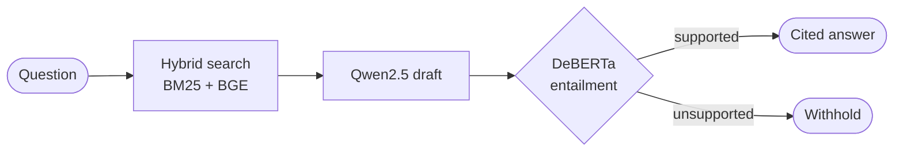

  

  

  
  
  
  
  
  
  

---

### Hi, I'm Dhanush

Data Science M.S. student at The George Washington University. AWS certified engineer with **9.8+ years** building distributed microservices, event-driven systems, and serverless data platforms for global enterprises, plus full-stack applications in Python, TypeScript, Node.js, JavaScript, SQL, and Angular.

---

### How a grounded answer is built

---

### Featured work

<table>
  <tr>
    <td width="50%" valign="top">
      <h4><a href="https://github.com/DhanushGWU1995/torque-diagnostics">Torque Diagnostics</a></h4>
      Technician assistant for ABB drive manuals. Still in progress. Hybrid retrieval, a Qwen2.5 draft, and a DeBERTa check that withholds a procedure the manual does not support. The repository is private while the manual library stays off the public internet.
        
        
    </td>
    <td width="50%" valign="top">
      <h4><a href="https://course-creator-626594108279.us-central1.run.app/">AI Course Creator</a></h4>
      Multi-agent system on Google Cloud Run. Researcher, fact-checker, and writer agents turn a topic into a course.
        
       
    </td>
  </tr>
  <tr>
    <td width="50%" valign="top">
      <h4><a href="https://github.com/DhanushGWU1995/6202-machine-learning-project">ECRIS</a></h4>
      Complaint intelligence on U.S. consumer-finance data, using DistilBERT and T5. <a href="https://huggingface.co/spaces/DhanushGWU1995/ECRIS">Live Space</a>
        
       
    </td>
    <td width="50%" valign="top">
      <h4><a href="https://github.com/DhanushGWU1995/sample-chat-bot">PartSelect assistant</a></h4>
      Appliance-parts chat with a swappable DeepSeek or OpenAI backend.
        
       
    </td>
  </tr>
</table>

<b>More projects</b>

 

- **[Health status predictor](https://github.com/DhanushGWU1995/6103-data-mining-project)**: CatBoost model on CDC BRFSS responses, with an Angular and Flask app.
- **[Heart disease predictor](https://github.com/DhanushGWU1995/6101-mid-term-project)**: CDC survey model. [Scoring app](https://dhanushgwu1995.github.io/6101-mid-term-project/predict)
- **[US unemployment vs job postings](https://github.com/DhanushGWU1995/6401-data-visualization-project)**: Tableau dashboard comparing U.S. unemployment with job postings across five economic sectors.
- **[Role Matrix](https://github.com/DhanushGWU1995/role-matrix)**: resume screening that scores skills and projects, not keywords.

---

### Experience

<b>Technical AWS Support Assistant</b> · The George Washington University (DC, US) · <i>Aug 2026 – Present</i>

 

- Built an AWS Connect, Lex, and Lambda contact center with intent-based self-service, cutting estimated tier-1 manual escalations by 42%.
- Built an EventBridge, S3, Bedrock, and Amazon Q pipeline that publishes knowledge updates every 15 minutes.
- Own reliability for 10,000+ users and 5,000+ network endpoints, with incident logs in Splunk Cloud.

<b>Data Science Intern</b> · Probability Solutions LLC (VA, US) · <i>Jun 2026 – Aug 2026</i>

 

- Studied binary search tree algorithms and how they apply to modern database engines.
- Built prototypes and measured tree-based algorithms on large inputs.
- Compared search, insert, delete, and update cost across search-tree implementations.

<b>Technical Project Specialist / Lead Engineer</b> · Bosch · Client MHP Porsche (Audi AG, Germany) · <i>Mar 2024 – Aug 2025</i>

 

- Shipped the Porsche workforce-planning platform on AWS serverless: CDKTF, Lambda, API Gateway, DynamoDB, and Cognito.
- Built event-driven HR ingestion with JSON schema validation, S3-triggered Lambda, and API Gateway.
- Synchronized legacy enterprise systems through SNS, SQS, and Lambda.

<b>Custom Software Engineering Team Lead</b> · Accenture · Client Educational Testing Service (NJ, US) · <i>Sep 2021 – Mar 2024</i>

 

- Cut ETS exam-result processing time by 50% with Lambda, DynamoDB, SNS/SQS, and CloudFormation.
- Validated candidate score events with AJV and processed them through SQS-triggered Lambda workflows.
- Automated DynamoDB maintenance in Node.js and Python and shipped reusable TypeScript service components.

<b>Lead Engineer, Full Stack Cloud Engineering</b> · HCL · Client Roche (Switzerland) · <i>Nov 2020 – Sep 2021</i>

 

- Cut Roche diagnostic reporting time by 40% with Node.js, Express, Angular, and MySQL.
- Automated PDF and Excel report generation and reduced manual reporting across laboratory workflows.
- Secured clinical integrations with OAuth and JWT APIs and AWS S3 storage.

<b>Software Engineer, Full Stack</b> · Object Frontier Software · Client IFF (NY, US) · <i>Aug 2018 – Nov 2020</i>

 

- Built an offline-first Electron desktop app with an embedded Node.js server and SQLite/MySQL sync for manufacturing and supply-chain work.
- Implemented Angular NgRx state management, including undo and redo across enterprise transactions.
- Connected Node.js microservices to MySQL with Sequelize and added structured logging with Winston.

<b>Software Engineer, Full Stack</b> · V2Soft · Client Fiat Chrysler Automotives (MI, US) · <i>Oct 2016 – Aug 2018</i>

 

- Built automotive HMI dashboards with Angular, HTML5, and Bootstrap for infotainment and diagnostics.
- Processed vehicle telemetry with MongoDB batch jobs and Node.js APIs.
- Connected dashboard modules to Node.js services with Socket.IO for live operational data.

---

### Toolbox

  

| | |
| --- | --- |
| **LLMs and NLP** | Retrieval-augmented generation · Amazon Bedrock · Amazon Q · Amazon Lex · Qwen2.5 · BGE embeddings · BM25 · DeBERTa · Hugging Face · DistilBERT · T5 |
| **Machine learning** | TensorFlow · scikit-learn · Pandas · Polars · PySpark · Matplotlib · Seaborn |
| **Cloud** | EC2 · CDKTF · Lambda · AWS Connect · AWS Lex · EventBridge · CDK · S3 · API Gateway · IAM · CloudFormation · Cognito · SQS/SNS · AWS EMR · Cloud Watch · Splunk · Docker · Terraform · Jenkins · GitHub Actions |
| **Application stack** | Python · TypeScript · JavaScript · SQL · R · Node.js · Express · Angular · FastAPI · Streamlit · Kafka · Redis |
| **Data stores** | DynamoDB · MySQL · MongoDB · SQLite · DuckDB · Tableau |

---

### Recognition and education

- **M.S. Data Science**, The George Washington University · Aug 2025 – May 2027. Coursework: Big Data Analytics, Cloud Computing, Machine Learning, Deep Learning, NLP, Data Warehousing.
- **B.E. Computer Science**, Anna University BIT Campus · Aug 2012 – April 2016. Coursework: Data Structures, Computer Programming, Software Engineering, Web Application Development, Algorithm Design.
- Phi Delta Gamma Fellowship, George Washington University (2026)
- Global Leaders Fellowship, George Washington University (2025)
- Introduction to R, DataCamp (2025)
- AWS Certified Solutions Architect – Associate, SAA-C03 (2024)
- AWS Certified Developer – Associate, DVA-C02 (2023)
- Client Value Creation Award and Best People Award, Accenture (2022)

---

### GitHub stats

  
  

  

